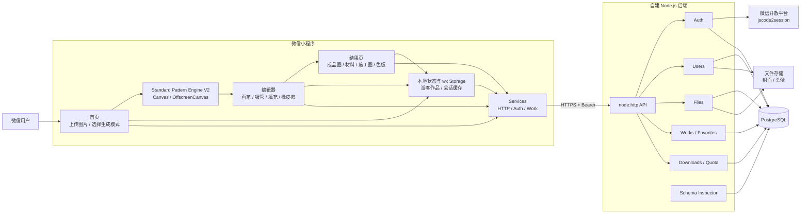

# 一起拼豆吧 · 当前系统架构

> 状态：当前实现基线
>
> 适用版本：0.19.x
>
> 本文描述当前已经落地的系统，不包含尚未接入的 Ai 模式未来 AI 架构见 `docs/backend/AI_GENERATION_DESIGN.md`

## 1. 总体架构



## 2. 当前核心链路

### 2.1 标准模式

```text
用户选图
→ 小程序本地中心裁剪
→ 4× 中间 Canvas
→ Linear RGB Area Average
→ Standard Pattern Engine 生成 PatternDraft
→ 编辑器人工调整
→ 结果页生成成品图 / 材料清单 / 施工图 / 色板
→ 游客本地保存；登录用户默认保存云端，网络错误时按账号暂存并自动补传
→ 成功导出后记录下载并扣减额度
```

标准模式的图案生成发生在客户端，不需要把用户原始图片上传到后端

### 2.2 登录与云端作品

```text
wx.login
→ POST /api/auth/login
→ 服务端调用微信 jscode2session
→ 建立用户 / 会话
→ 返回 Bearer token
→ 小程序后续访问用户、作品、收藏、下载接口
```

登录或恢复登录后，客户端先切换到当前账号的数据空间并恢复云端作品、收藏；游客作品经一次性确认后迁移。运行期云端缓存不会持久化，待同步作品按账号隔离；迁移成功后使用云端作品 ID 替换本地关联 ID，失败则保留本地作品并标记同步状态。

### 2.3 下载额度

```text
设备端先生成并成功保存文件
→ POST /api/downloads + Idempotency-Key
→ PostgreSQL 事务锁定用户
→ 懒发放当日免费额度
→ 校验作品归属
→ 优先消耗 daily_free
→ 不足时消耗 purchased
→ 写下载记录与额度流水
→ COMMIT
```

取消、生成失败或保存相册失败时，不应调用下载扣减接口

## 3. 小程序包结构

### 主包

- `pages/home/index`
- `pages/projects/index`
- `pages/profile/index`

### 分包 `pages-sub`

- editor
- result
- favorites
- downloads
- help
- feedback
- privacy
- about
- recharge
- payment-success

## 4. 后端模块

| 模块 | 当前职责 |
| --- | --- |
| `auth` | 微信登录、用户识别、Bearer 会话 |
| `users` | 用户资料、头像 |
| `files` | 作品封面上传与文件元数据 |
| `works` | 作品 CRUD、Pattern 持久化、收藏 |
| `downloads` | 下载记录、每日免费额度、购买额度、幂等扣减 |
| `db` | PostgreSQL Pool、Schema Contract、运行时检查 |

## 5. 数据存储边界

- PostgreSQL：用户、会话、文件元数据、作品、Pattern、收藏、下载记录、额度流水、套餐、订单
- 文件存储：头像、作品封面等二进制文件
- wx Storage：游客数据、客户端会话缓存和必要的本地状态
- 原始上传图片：标准模式当前不要求服务端永久保存

## 6. 架构事实来源

出现文档与代码不一致时，按以下优先级判断：

1. 当前可运行代码与 PostgreSQL 实际 Schema
2. `server/src/db/schema-contract.ts`
3. `docs/backend/database/DATABASE_SCHEMA.md`
4. 本文
5. 历史架构快照

## 7. 维护规则

以下变化发生时必须更新本文：

- 新增后端业务模块
- 主包 / 分包结构变化
- 数据存储边界变化
- 标准模式生成链路变化
- Ai 模式正式接入生产
- 文件存储或 PostgreSQL 架构发生变化
