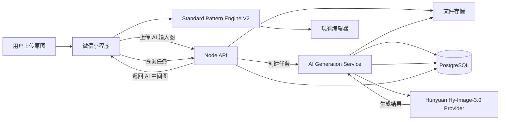

# 一起拼豆吧 · Ai 模式接入设计

> 状态：CloudBase 混元 Provider 与 Prompt v3 已实现并设为新任务默认，待服务端部署、预发布环境和真机验收
>
> 当前标准模式继续使用本地 Standard Pattern Engine；Ai 模式作为独立上游图像处理能力接入，不替换现有 Pattern Schema

## 1. 目标

Ai 模式解决的问题不是“让模型直接输出最终拼豆格子”，而是：

```text
用户原图
→ AI 生成更适合拼豆化的中间图
→ Standard Pattern Engine
→ PatternDraft
→ 编辑器
→ 成品图 / 材料清单 / 施工图 / 色板
```

这样可以保持最终网格、颜色、材料统计和施工图的确定性，也便于未来替换 AI 模型

## 2. 模型选择

### 当前代码默认模型：腾讯混元 Hy-Image-3.0

适合原因：

- 支持参考图片和指令控制，适合“保留主体、减少细节、加强轮廓、控制背景”等拼豆前处理
- `generateImage` 云函数通过微信云函数环境内置的 `wx-server-sdk` 调用 `hunyuan-image`，模型 ID 为 `HY-Image-v3.0-I2I-ToB-v1.0.1`
- 国内云服务接入更适合微信小程序生产环境
- 服务端通过 `@cloudbase/node-sdk` 调用 `generateImage` 云函数，不需要让小程序直连模型厂商

新任务默认使用 Hy-Image-3.0，服务端固定 `revise={ value: false }`，减少不必要的 Prompt 改写等待；云函数使用「AI生成」作为显式标识文案。

### Benchmark / 备用：OpenAI GPT-Image-2

用途：

- 作为图像质量和指令遵循 benchmark
- 用于内部 A/B 测试不同 provider 的拼豆转换效果
- 如果未来具备稳定网络、成本和合规条件，可作为备用 Provider

### 首版实现原则

当前只有混元一个生产实现，直接使用一个小的 `hunyuan-image-provider.ts` 模块，不提前定义 Factory、Plugin Registry 或多层 Adapter。

## 3. AI Prompt 目标

AI 的输出应该针对后续 Pattern Engine，而不是追求摄影级细节

建议固定系统模板控制：

- 保留主体身份、姿态和主要构图
- 简化细碎纹理
- 减少背景噪声
- 强化主体与背景色块差异
- 保持明显轮廓
- 控制颜色数量和渐变复杂度
- 避免生成文字、水印和额外物体
- 输出方形或与目标拼豆网格匹配的构图

用户首版不需要看到自由 Prompt 输入框产品只暴露少量可控参数，例如：

- 风格：Q 版 / 自然 / 卡通 / 极简
- 细节：低 / 中 / 高
- 背景：保留 / 简化 / 去除

服务端根据这些参数组装版本化 Prompt

### 3.1 Prompt v3 约束

当前生产模板版本为 `v3`，由服务端生成，客户端不能提交或覆盖 Prompt。模板包含：

- 保留输入图片的主要主体、身份、姿态和核心构图；主体比例按所选风格处理
- 减少细碎纹理、无关小物体和复杂噪声
- 强化主体轮廓、明暗关系和主体与背景的色块对比
- 根据 `kawaii`（独立 Q 版）、`natural`、`cartoon`、`minimal` 选择视觉风格
- 根据 `low`、`medium`、`high` 控制细节保留程度
- 根据 `keep`、`simplify`、`remove` 控制背景处理方式
- 禁止生成拼豆网格、材料标记、施工图、边框、Logo、水印或额外文字
- 要求输出完整 PNG，供 Standard Pattern Engine 继续处理

Prompt 版本写入 `pindou_ai_generation_jobs.prompt_version`。修改模板必须升级版本，不回写历史任务。

## 4. 推荐架构



## 5. 同步还是异步

首版建议从 API 语义上按“任务”设计，即使所选模型当前可以同步返回

原因：

- 图片生成延迟明显高于普通 API
- 模型供应商可能超时、排队或限流
- 后续切换异步模型时无需修改客户端业务协议
- 用户退出页面后仍可以恢复任务状态

小程序不应保持一个很长的 HTTP 请求等待生成完成。当前客户端首次进入页面立即查询，之后默认每 4 秒查询一次；连续网络失败时按 8 秒、15 秒、30 秒退避，页面隐藏或卸载时清理计时器。

## 6. 数据库改动

### 6.1 现有表需要调整

#### `pindou_file_assets`

当前 `file_type` 主要面向 `cover`AI 模式需要至少增加：

- `ai_input`：用户上传、提供给模型的输入图片
- `ai_output`：模型生成的中间图片

AI 输入图建议设置有限保留期，不建议永久保存所有原图

### 6.2 新增 `pindou_ai_generation_jobs`

首版只增加一张任务表，不拆 request/result/provider 多张表

建议字段：

| 字段 | 类型 | 说明 |
| --- | --- | --- |
| `id` | varchar(32) PK | `aij_` 前缀 |
| `user_id` | varchar(32) FK | 用户 |
| `input_file_id` | varchar(32) FK | AI 输入文件 |
| `output_file_id` | varchar(32) FK NULL | AI 生成结果 |
| `provider` | varchar(30) | 当前为 `hunyuan` |
| `model` | varchar(80) | 实际模型 ID |
| `status` | varchar(20) | queued / processing / succeeded / failed / canceled |
| `prompt_version` | varchar(30) | Prompt 模板版本 |
| `style` | varchar(30) | 产品风格参数 |
| `detail_level` | varchar(20) | 细节级别 |
| `background_mode` | varchar(20) | 背景策略 |
| `provider_request_id` | varchar(128) NULL | 厂商请求 ID |
| `error_code` | varchar(60) NULL | 失败分类，不直接保存敏感厂商原始报错 |
| `created_at` | timestamptz | 创建时间 |
| `started_at` | timestamptz NULL | 开始处理 |
| `completed_at` | timestamptz NULL | 完成时间 |
| `expires_at` | timestamptz NULL | 输入/输出文件清理时间 |

暂时不新增单独的 `ai_generation_results` 表，因为首版一个任务只需要一个最终候选图如果未来确定支持“一次生成 4 张让用户选择”，再新增结果表

### 6.3 AI 次数 / 付费额度

不要直接把 AI 次数与现有“下载次数”混成同一个余额

推荐先把额度模型升级成显式资源类型，例如给 `pindou_quota_transactions` 增加：

```text
quota_kind = download | ai_generation
```

然后同一流水模型继续支持：

- 每日免费 AI 次数
- 购买 AI 次数
- AI 生成成功扣减
- 失败不扣减 / 自动返还

如果短期尚未收费，也可以先不改额度表，只给 AI 任务建立免费限流；正式上线每日免费 3–5 次和付费能力前，再落地 `quota_kind`

## 7. API 增量设计

### 7.1 上传 AI 输入图

推荐继续复用文件上传入口：

```http
POST /api/files/upload
Content-Type: multipart/form-data
Authorization: Bearer ...

type=ai_input
file=<image>
```

不新增一个重复的 `/api/ai/upload`

### 7.2 创建生成任务

```http
POST /api/ai/generations
Authorization: Bearer ...
Idempotency-Key: ...
Content-Type: application/json
```

请求：

```json
{
  "inputFileId": "file_xxx",
  "style": "natural",
  "detailLevel": "medium",
  "backgroundMode": "simplify"
}
```

返回：

```json
{
  "id": "aij_xxx",
  "status": "queued"
}
```

客户端不能提交 provider、model、system prompt 或任意厂商参数；这些全部由服务端配置

### 7.3 查询任务

```http
GET /api/ai/generations/{id}
```

处理中：

```json
{
  "id": "aij_xxx",
  "status": "processing"
}
```

成功：

```json
{
  "id": "aij_xxx",
  "status": "succeeded",
  "inputFileId": "file_input_xxx",
  "outputFile": {
    "id": "file_output_xxx",
    "url": "https://api.example.com/api/media/ai/ai_output_xxx.png",
    "contentType": "image/png",
    "size": 123456
  }
}
```

失败：

```json
{
  "id": "aij_xxx",
  "status": "failed",
  "errorCode": "AI_PROVIDER_ERROR"
}
```

### 7.4 可选：取消任务

只有实际 Provider 支持取消且产品确实需要时再增加：

```http
POST /api/ai/generations/{id}/cancel
```

不要为了完整 REST 形式提前实现无效取消

## 8. 前端改动

首页已有 `standard | ai` 生成模式，可以继续复用现有状态

AI 模式流程建议：

```text
选择 Ai 模式
→ 选图
→ 上传 ai_input
→ POST /api/ai/generations
→ 展示 AI 处理中页面 / 状态
→ GET generation 状态
→ 成功后下载/读取 AI output
→ 交给现有 Standard Pattern Engine
→ 进入编辑器
```

小程序通过 `pindou-ai-generation-session-v1` 保存幂等键、任务 ID、输入文件 ID、原图临时路径、输出临时路径和首页 Pattern Settings。页面返回、切后台或请求丢失后，优先查询已有任务；输出已下载时优先复用本地文件。只有输出下载成功、本地 `createDraft()` 成功、当前草稿写入 AppStore 且成功跳转编辑器后才清理会话。

创建请求失败使用同一幂等键重试；明确失败后重新生成时复用 `inputFileId` 但生成新的幂等键；下载失败只重试下载；本地转换失败只重试 `createDraft()`。这些重试都不会重复消耗 AI 次数。

### 8.1 上线安全门槛

- Hunyuan API Key 只在服务端环境变量中读取；客户端只获得本项目的任务状态和持久化媒体地址。
- 输入和输出都执行服务端真实格式、大小、尺寸及像素数校验；输出地址必须使用 HTTPS，并由当前 Provider 的受信域名校验通过后以禁止跳转的方式下载。
- AI 输入上传和任务创建按用户限流；输入、输出默认 24 小时过期，过期任务和孤立输入由定时清理任务软删除并物理清理。
- AI 输入图片在上传阶段通过微信内容安全审核；混元输出不再经过本项目的微信二次审核，由混元服务商负责其生成结果审核。服务端继续执行输出地址、真实格式、大小、尺寸及像素数校验。
- 客户端只收到稳定错误码；Provider 原始响应、内部堆栈和敏感配置只进入受控服务端日志，且当前实现日志只记录稳定错误码。

这样编辑器、结果页、作品保存、Pattern Schema、材料清单和下载链路都不需要因为 AI 模式复制一套

## 9. 服务端模块建议

新增：

```text
server/src/modules/ai/
  ai-generation-service.ts
  hunyuan-image-provider.ts
```

首版不要新增：

- Provider interface
- BaseAiProvider
- ProviderFactory
- ProviderRegistry
- QueueFactory
- StrategyFactory
- 多层 repository abstraction

真正出现第二个 Provider 或独立 Worker 后再演进

## 10. 可靠性与成本

必须记录：

- Provider
- Model
- Prompt version
- 请求开始/完成时间
- 成功/失败状态
- Provider request ID

建议统计但不一定第一版入库：

- 单次生成成本
- 平均生成时长
- 成功率
- 用户从 AI 图进入编辑器的转化率
- AI 图最终保存为作品的比例

关键原则：

- AI API Key 只能放后端
- AI 输入图必须校验真实文件类型、大小和尺寸
- Provider 超时不能生成“假成功”
- 只有真正得到可用 AI 输出后才扣 AI 额度
- 重试必须结合 Idempotency-Key，避免用户被重复扣次

## 11. 实施阶段

### Phase A：技术验证

- 用 30–50 张典型图片测试 Hy-Image-3.0
- 固定 2–3 个 Prompt 模板
- 对比 Standard 原图直转与 AI 中间图再转的最终拼豆质量
- 记录生成时间和单图成本

### Phase B：后端 MVP

- 扩展 `file_type`
- 新增 `pindou_ai_generation_jobs`
- 新增 AI Provider 与 Service
- 新增创建 / 查询任务 API
- 不接支付

### Phase C：小程序接入（已实现，待环境验收）

- 打通 AI 模式真实流程
- AI 输出继续复用 Standard Pattern Engine 和现有编辑器
- 加失败、重试、超时 UI
- 小程序不接触 Provider、Model、Prompt 或 API Key
- 任务页支持后台恢复、下载复用和本地转换重试

### Phase D：商业化

- 增加 `quota_kind=ai_generation`
- 每日免费 3–5 次
- 购买次数
- 成功扣减、失败不扣
- 增加运营和成本监控

## 12. 不需要因为 AI 改动的现有核心结构

以下结构原则上保持不变：

- `PatternDraft`
- `PersistedPattern`
- `pindou_works`
- `pindou_work_patterns`
- 编辑器工具系统
- 成品图 / 材料 / 施工图 / 色板逻辑
- 标准模式

AI 只是标准生成链路前增加一个可选的“图像预处理阶段”
