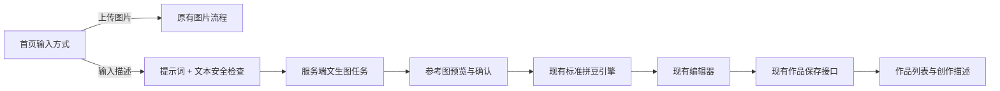

# 文生图与作品集设计

## 现状与决定

- 首页 `pages/home/index` 当前只接受图片；标准模式在本地转图，AI 模式进入 `aiTaskManager` 和服务端 AI 任务链路。
- `generateImage` 云函数有文生图模型分支，但没有用户身份、任务列表、额度控制或作品来源记录。
- `/api/works` 已在一个事务中保存封面与 `pindou_work_patterns`；`pindou_works` 目前没有创作来源与提示词字段。
- `generationMode` 表示拼豆转换方式（`standard` / `ai`），不能复用为输入来源。
- 现有 `pindou_ai_generation_jobs` 强制要求输入图片并保存图生图专属参数，因此不伪造输入文件，也不扩大旧任务表的含义。

因此增加独立的“创作来源”概念：`creationSource = image | text`，它与 `generationMode` 分开保存。

## 用户流程与 UI

### 首页

- 首页主标题改为能同时承接图片与文字的“让脑海里的灵感，变成拼豆作品”，小标签为“小露拼豆”；用少量拼豆圆点和绿白底色传达手作质感，不改变现有品牌主色。
- 在现有输入区域内加入“上传图片 / 描述想法”分段切换，标题“从哪里开始？”，让两类来源共用一个创作入口。
- 文本状态展示提示词、500 字计数和安全提示；主按钮为“生成灵感图”。
- 文生图成功后先展示参考图预览，用户确认后进入现有标准拼豆生成及编辑流程。首版不展示标准/AI 二次优化选择，避免隐式多调一次模型和产生额外费用。
- 参考图预览就长在创作页里（按钮上方预留展示位），不再跳转独立结果页：空态显示占位提示，生成中显示进度，成功后原地出图并给出“生成拼豆图 / 重新生成”，失败可原地重试。任务编号写在本机，离开页面后再进来仍能恢复这张参考图；已确认过的结果仍由作品页承担长期入口。
- AI 灵感结果在本机缓存 6 小时，进入页面优先复用缓存，只有无缓存/已过期或用户点“换一换”才真实调用文本模型；这是唯一“不扣用户额度却真实消耗 token”的调用。
- 图片状态保持现有标准/AI 模式卡及图片检测流程。

### 作品页

- 保留现有“全部 / 最近 / 草稿 / 已完成”筛选与作品卡布局，不增加一级导航、来源筛选或单独作品类型。
- 进行中的文生图任务以可恢复任务卡显示在作品列表，与现有 AI 任务卡统一呈现；失败任务可重试。
- 已完成作品卡片增加“文字生成”来源标识；旁边的“查看描述”打开轻量创作描述面板，点击作品主体仍沿用现有结果页跳转。

### 当前原型

交互式 UI 原型：`C:\Users\ImAca\.codex\visualizations\2026\09\28\01a0e840-a2ba-7941-9f93-60c7c336938b\text-image-workflow.html`。

## 服务端方案

### 任务 API

- `POST /api/ai/text-generations`：Bearer 登录；必带 `Idempotency-Key`；请求只接收 `{ "prompt": "..." }`。模型、Provider、API Key、系统提示词和额度字段都由服务端控制。
- `GET /api/ai/text-generations/{id}`：返回状态、可访问输出、稳定错误码和时间戳。
- `GET /api/ai/text-generations?active=true`：返回当前用户可恢复的活动/失败任务，供作品页合并展示。
- 任务状态为 `queued → processing → succeeded/failed`。参考图作为短期 AI 输出文件保存并按当前 AI 文件校验策略验证大小、尺寸和真实格式；任务与输出按既有保留策略过期清理。

### Provider 与安全

- 新增小型服务端文生图 Provider，固定使用 `HY-Image-3.0-Plus-4090-Tob-v1.0`；沿用已有 CloudBase 混元 SDK 能力与 AI 文件存储/格式验证。
- 小程序不直接调用公开的 `generateImage` 云函数。云函数/Provider 入口改由已鉴权的服务端任务调用，避免绕过用户归属、限额和审计。
- 服务端对提示词执行内容安全检查；只记录脱敏后的任务标识、模型名、Provider request ID 和失败码，不记录密钥或不必要的完整提示词日志。
- 任务创建按用户和幂等键去重；额度在参考图生成并成功落盘后扣 1 次，失败不扣；图案转换与作品保存不再次扣额度。

### 持久化

新增 `pindou_text_image_generation_jobs`，仅保存短期生成工作流：

单独建表是为了保留现有图生图任务的 `input_file_id` 与风格参数约束；额度账本、CloudBase 混元 SDK、输出文件校验和文件存储仍复用现有模块。

| 字段 | 用途 |
| --- | --- |
| `id`, `user_id` | 任务归属与身份校验 |
| `prompt` | 生成和任务恢复，最多 500 字 |
| `provider`, `model` | 创建任务时的服务端配置快照 |
| `status`, `output_file_id` | 状态与短期结果 |
| `idempotency_key`, `provider_request_id`, `error_code` | 重复提交、追踪与稳定失败展示 |
| `created_at`, `updated_at`, `completed_at`, `expires_at` | 恢复与清理 |

作品仍使用原有 `pindou_works` + `pindou_work_patterns`，通过新迁移添加：

- `creation_source varchar(20) NOT NULL DEFAULT 'image'`，CHECK `image | text`。
- `source_prompt text NULL`；仅 `creation_source='text'` 时有值，限制 1–500 个字符。
- 列表摘要返回 `creationSource`；作品详情额外返回 `sourcePrompt`。
- 新建/更新作品请求允许 `creationSource` 和 `sourcePrompt`；服务端严格校验两者组合，并将它们与网格、封面写在同一事务中。老客户端省略来源字段时仍按 `image` 处理。
- `PatternDraft` / 本地草稿 / 离线待同步项携带这两个来源字段，保证游客本地作品和稍后云同步都能保留提示词。

成功保存的作品封面使用现有 `cover_file_id` 保存生成参考图，图案仍写入现有 `pindou_work_patterns`；不新增永久参考图资产引用。提示词复制到作品记录后不受短期任务清理影响。

提示词会发送给腾讯混元进行生成。隐私政策和第三方共享清单应说明这一点；已保存作品的提示词随作品保留，删除作品时一并删除。任务过期后清理短期任务提示词和中间产物，日志不记录完整提示词。

## 失败与恢复

- 任务创建后立即返回任务 ID，不让小程序等待同步模型请求；重进作品页通过任务列表接口恢复状态。
- Provider 失败按稳定错误码显示重试；同一幂等键对应同一请求，重试动作使用服务端既有幂等/重排队规则。
- 模型输出下载、内容格式校验或持久化失败时任务失败且不扣额度。
- 参考图成功后，客户端转换或编辑失败时复用已持久化参考图，不重新发起模型任务。
- 作品保存失败时保留本地 `PatternDraft` 与提示词，沿用当前离线待同步与重试规则。

## 兼容与验证重点

- 数据库迁移为向前兼容：历史记录默认 `creation_source=image`，旧客户端请求契约不变。
- 复用现有内容安全、AI 额度账本、AI 文件格式/尺寸限制、作品事务和离线同步机制。
- 实现阶段覆盖：用户隔离、幂等冲突、提示词边界/安全拒绝、额度只扣一次、输出失败不扣、过期清理、文生图作品详情恢复、旧作品读写、离线同步，以及首页/作品页真机布局检查。

## 实施边界

产品已确认额度规则为“参考图生成成功扣 1 次、失败不扣”，且首版只走标准拼豆转换。实施按本设计和 `tasks.md` 推进；未涉及部署与生产迁移执行。
