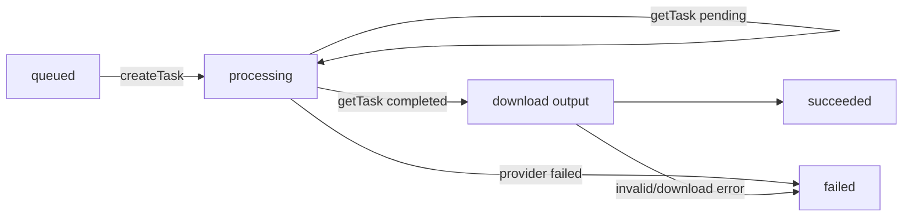

# ToAPIs 生图 Provider 迁移设计

状态：Draft

## 1. 设计结论

采用“异步 Provider 合同 + 数据库驱动轮询 + 迁移期双 Provider”的方案：

- 新任务默认进入 ToAPIs。
- 旧任务按照数据库保存的 `provider` 和 `model` 快照选择混元或 ToAPIs，不通过当前默认配置猜测。
- 第一阶段使用 ToAPIs 任务查询接口完成收口；第二阶段可增加 Webhook，Webhook 只负责加速收口，轮询仍作为兜底。
- 不把 ToAPIs SDK 引入服务端，使用原生 `fetch` 调用明确的 HTTP 契约，减少依赖和版本漂移。

ToAPIs 的 GPT-Image-2.5 普通版是异步任务协议，支持 `reference_images` URL、`size`、`resolution`、`quality` 和 `n=1`；任务状态需要通过任务 ID 查询，完成后从 `result.data[].url` 获取图片。首选模型暂定 `gpt-image-2.5-sunburst`，因为当前业务是参考图驱动的图生图；如质量/延迟对比后选择 Flare，只修改配置值。

## 2. 现状与问题

当前 `hunyuan-image-provider.ts` 同时承载了三类职责：Provider 接口、错误类型和混元实现。其 `createTask` 假定一次调用即可取得输出引用，`ai-generation-service.ts` 没有 Provider 任务查询阶段；输入也被编码成 data URL，无法直接满足 ToAPIs 的参考图 URL 要求。

迁移不能只把环境变量改成 `TOAPIS_*`，否则会出现：

1. ToAPIs 返回 `pending` 后项目任务没有后续推进路径。
2. 小程序每次轮询都触发 ToAPIs 查询，短时间内打满查询限流。
3. ToAPIs 返回的 `files.toapis.com` 或其它配置域名被旧的混元域名白名单拒绝。
4. 部署后存量混元任务被错误地拿去查询 ToAPIs。
5. 输出 URL 过期前未及时下载，任务在项目侧变成假成功。

## 3. 模块边界

### 3.1 共享 Provider 合同

新增 `server/src/modules/ai/provider.ts`，从现有混元文件迁移公共类型：

```ts
type ProviderTaskState = "pending" | "completed";

interface AiGenerationProvider {
  readonly configured: boolean;
  readonly name: "hunyuan" | "toapis";
  readonly model: string;
  createTask(input: {
    referenceImageUrl: string;
    prompt: string;
    clientBusinessId: string;
  }): Promise<{ requestId: string }>;
  getTask(requestId: string): Promise<
    | { state: "pending" }
    | { state: "completed"; outputUrl: string }
  >;
  downloadOutput(outputUrl: string): Promise<Buffer>;
}
```

`ProviderError`、`ProviderFailureKind`、输出格式识别函数和统一错误码也迁移到共享模块；供应商实现只负责把自己的响应映射成共享合同。

### 3.2 ToAPIs Provider

新增 `server/src/modules/ai/toapis-image-provider.ts`：

1. `createTask`：
   - `POST {baseUrl}/v1/images/generations`
   - `Authorization: Bearer ${TOAPIS_API_KEY}`
   - 请求体使用完整模型 ID、固定 `quality=high`、`size=1:1`、`resolution=1K`、`n=1`、参考图 URL和 `client_business_id=jobId`。
   - 只返回并校验 ToAPIs 任务 ID，不把任务当作已完成。
2. `getTask`：
   - `GET {baseUrl}/v1/images/generations/{requestId}`。
   - `pending`、`queued`、`in_progress` 映射为 `pending`。
   - `completed` 必须提取 `result.data[0].url`，缺失则抛 `AI_PROVIDER_OUTPUT_INVALID`。
   - `failed` 把供应商错误码写入受控日志，公开只映射稳定错误码。
3. `downloadOutput`：
   - 只接受 HTTPS、无 userinfo、无非预期端口的 URL。
   - hostname 必须命中 `TOAPIS_IMAGE_OUTPUT_HOSTS` 精确/后缀白名单。
   - 禁止跟随重定向；按真实字节魔数校验 PNG/JPEG/WEBP、大小和后续像素约束。
   - 不做任何底部比例裁切或水印规避。

### 3.3 任务服务改造

`ai-generation-service.ts` 保留现有额度、幂等和项目任务状态机，只新增 Provider 查询阶段：



需要新增 `provider_next_poll_at timestamptz NULL`，并增加迁移脚本：

- 提交成功后设置下一次可查询时间。
- 查询未完成时设置 `now + 5~10 秒 + 抖动`。
- 查询完成或失败时清空该字段。
- 多副本通过数据库时间字段限流，不依赖单机内存 Map。

Provider 选择使用 `Map<providerName, AiGenerationProvider>`：新任务使用配置的默认 Provider；读取任务时使用行内 `provider`。第一阶段保留混元适配器只用于存量任务，禁止新任务再写入 `hunyuan`。

### 3.4 输入图片策略

ToAPIs 普通图像接口的参考图只接受服务可访问的 URL。第一阶段不新增 ToAPIs 文件上传生命周期，直接由项目 AI 文件存储生成输入图片 URL：

- `AiFileStorage` 增加受校验的 `publicUrl(objectKey)` 方法。
- Provider 收到的 URL由服务端根据数据库中的 `input_object_key` 生成，不接受用户传入的 URL。
- 生产启动时校验 `AI_FILE_PUBLIC_BASE_URL` 为 HTTPS；部署必须确保 ToAPIs 能从公网读取该 URL。
- 若未来关闭公网访问，再切换为 ToAPIs 上传接口，并将上传对象生命周期纳入任务清理；本阶段不提前引入。

## 4. 配置设计

新增配置段 `toapisImage`，建议环境变量：

```dotenv
TOAPIS_IMAGE_API_KEY=***
TOAPIS_IMAGE_BASE_URL=https://api.toapis.cn
TOAPIS_IMAGE_MODEL=gpt-image-2.5-sunburst
TOAPIS_IMAGE_SIZE=1:1
TOAPIS_IMAGE_RESOLUTION=1K
TOAPIS_IMAGE_QUALITY=high
TOAPIS_IMAGE_TIMEOUT_MS=30000
TOAPIS_IMAGE_POLL_INTERVAL_MS=7000
TOAPIS_IMAGE_MAX_OUTPUT_BYTES=10485760
TOAPIS_IMAGE_OUTPUT_HOSTS=files.toapis.com
```

说明：

- 中国大陆生产默认使用 `https://api.toapis.cn`；开发环境可显式使用 `https://api.toapis.com`，不在代码中自动猜测地域。
- 模型、比例和分辨率由服务端控制，客户端不可覆盖。
- `TOAPIS_IMAGE_OUTPUT_HOSTS` 必须是逗号分隔的主机名白名单；不使用 `*`。
- 生产环境要求 API Key、Base URL、模型、输出白名单齐全；Hunyuan 配置只在迁移排空期作为旧任务兼容配置存在。

## 5. 错误与重试

| ToAPIs 场景 | Provider kind | 项目内部码 | 处理 |
| --- | --- | --- | --- |
| 401/403 | UNAVAILABLE | `AI_SERVICE_UNAVAILABLE` | 配置/密钥问题，不自动重试 |
| 提交或查询 429 | RATE_LIMITED | `AI_PROVIDER_RATE_LIMITED` | 读取 `Retry-After`，任务保持可重试 |
| 提交 503 `rate_limit_unavailable` | UNAVAILABLE | `AI_PROVIDER_UNAVAILABLE` | 短退避，不在 HTTP 请求内等待 |
| 任务最终 `failed` | UNKNOWN | `AI_PROVIDER_TASK_FAILED` | 失败收口，不暴露上游 message |
| 完成但无图片 URL | INVALID_OUTPUT | `AI_PROVIDER_OUTPUT_INVALID` | 失败收口，不扣额外额度 |
| 输出 URL不在白名单 | INVALID_OUTPUT | `AI_PROVIDER_OUTPUT_INVALID` | 拒绝下载并告警 |
| 输出下载超时/5xx | TIMEOUT/UNAVAILABLE | 现有稳定错误码 | 保持现有临时错误处理 |

提交阶段延续当前“限流退回 queued、全局冷却”的策略；查询阶段不新建 ToAPIs 任务。失败重试只能通过现有项目任务重试语义重新创建/重排队，不能复用已失败的 ToAPIs 任务 ID。

## 6. 迁移与发布

### 阶段 A：实现与测试

- 共享 Provider 合同、ToAPIs Provider、配置解析、数据库轮询字段和测试全部落地。
- 默认 Provider 可以在开发环境切到 ToAPIs；生产默认仍不切换。
- 使用录制/模拟的 ToAPIs 响应覆盖 pending、completed、failed、429、503、401、过期 URL和跳转。

### 阶段 B：预发布验收

- 配置 ToAPIs 测试 Key 和 `gpt-image-2.5-sunburst`，完成真实参考图生成。
- 核对完整图片、无底部固定裁切、输出格式、生成耗时、失败率和单位成本。
- 验证 ToAPIs 能访问项目输入图 URL，验证服务端下载后立即清空临时 URL。

### 阶段 C：生产灰度

- 新任务切到 ToAPIs；存量混元任务继续由混元 Provider 处理。
- 观察 24 小时：提交成功率、完成率、P50/P95 生成时长、429/503、输出校验失败、额度扣减和任务积压。
- ToAPIs 连续稳定后，停止创建混元任务并等待混元存量任务排空。

### 阶段 D：删除混元

- 确认数据库没有 queued/processing 的混元任务，并保留必要历史记录的 `provider/model` 快照。
- 移除 Hunyuan Provider、`HUNYUAN_IMAGE_*` 配置、旧云函数依赖、旧测试和旧文档。
- 发布版本说明中明确：生图已切换 ToAPIs，结果不再执行混元水印裁切逻辑。

## 7. 观测与验收指标

- `ai_provider_task_submitted`：provider、model、项目 jobId、ToAPIs requestId、耗时；不记录 API Key/Prompt/完整 URL。
- `ai_provider_task_polled`：状态、轮询耗时、attempt；不记录图片内容。
- `ai_provider_output_declared` / `ai_provider_output_rejected`：URL 主机、格式、大小和拒绝原因。
- 生成成功率、Provider 失败率、429/503 比例、平均/分位生成时长、任务超过 15 分钟数量。
- 验收必须证明：成功只扣一次额度，失败不扣额度，结果完整保存，用户 API 响应不泄露供应商详情。

## 8. 参考文档

- [ToAPIs 文档索引](https://docs.toapis.com/llms.txt)
- [GPT-Image-2.5 图像生成说明](https://docs.toapis.com/docs/cn/api-reference/images/gpt-image-2.5/generation)
- [图片任务状态](https://docs.toapis.com/docs/cn/api-reference/tasks/image-status)
- [上传图片](https://docs.toapis.com/docs/cn/api-reference/uploads/images)
- [异步任务速率限制](https://docs.toapis.com/docs/cn/api-reference/rate-limits/async-tasks)
- [异步任务 Webhook](https://docs.toapis.com/docs/cn/api-reference/webhooks/task-webhooks)
