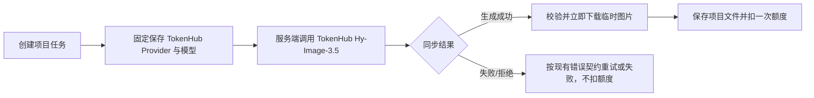

# ToAPIs 到腾讯 TokenHub 混元 Hy-Image-3.5 迁移设计

## 调用路径

旧任务按数据库快照分流：`provider=toapis` 仍用 ToAPIs，`provider=hunyuan` 仍用 CloudBase 混元；只有新任务固定使用 `hunyuan-tokenhub-v35`。这避免改写正在处理的上游任务 ID，也无需数据库迁移。

## TokenHub 请求

- URL：`https://tokenhub.tencentmaas.com/v1/wand/hunyuan-image/v35-generation`
- 鉴权：服务端 `Authorization: Bearer <TOKENHUB_HUNYUAN_IMAGE_API_KEY>`
- 固定模型：`hy-image-v3.5-preview`
- 请求体包含 `session`、`size=1024x1024`、messages 中的 Prompt 与服务端 AI 文件 URL；省略可选 `footnote`。
- 参考图 URL 来自服务端文件存储，不接受客户端提供任意 URL。
- 从 `choices[0].delta.image.url` 取临时结果；限制输出主机、HTTPS、重定向、下载字节和真实图片格式，随后写入项目存储。

TokenHub 结果为同步返回。现有任务接口继续采用 queued/processing 状态，生成任务仍由后台提交和客户端轮询；无需新增数据库状态或改动小程序协议。

## 配置与路由

新增 `TOKENHUB_HUNYUAN_IMAGE_API_KEY`、`TOKENHUB_HUNYUAN_IMAGE_BASE_URL`、超时和输出大小配置。新任务 Provider 固定为 TokenHub，不提供 ToAPIs 选择或自动回退。生产启动要求 TokenHub 配置完整。

ToAPIs 配置与适配器仅服务旧快照任务；生产部署在旧任务排空前保留对应 Key。之后可做小型清理提交，删除 ToAPIs 适配器、配置、测试及环境变量。

## 错误与额度

- 422 映射内容拒绝，禁止通过其他模型绕过安全拒绝。
- 429 使用现有服务级限流冷却；5xx 与网络超时按现有临时失败策略处理。
- 鉴权、格式、输出 URL 或图片内容无效均不成功、不扣用户额度。
- 图片保存成功后由现有事务将任务标记 succeeded 并扣一次 `ai_generation`。

## 发布步骤

1. TokenHub 生产账户完成开通、预算及 Key 配置；更新隐私共享清单。
2. 预发布构建与测试；使用省略 `footnote` 的真实请求核验生成、下载、存储、额度与错误处理。
3. 发布新服务端；确认新任务快照及日志 Provider 为 `hunyuan-tokenhub-v35`，没有新增 ToAPIs 调用。
4. 监控成功率、耗时、429/422、下载失败和上游 TokenHub 用量。
5. 只读检查旧 ToAPIs queued/processing 任务；排空后删除旧 Provider 和服务端 ToAPIs 凭据。

不触碰线上 Key、数据库或部署环境；这些步骤由有生产权限的发布人员执行。
